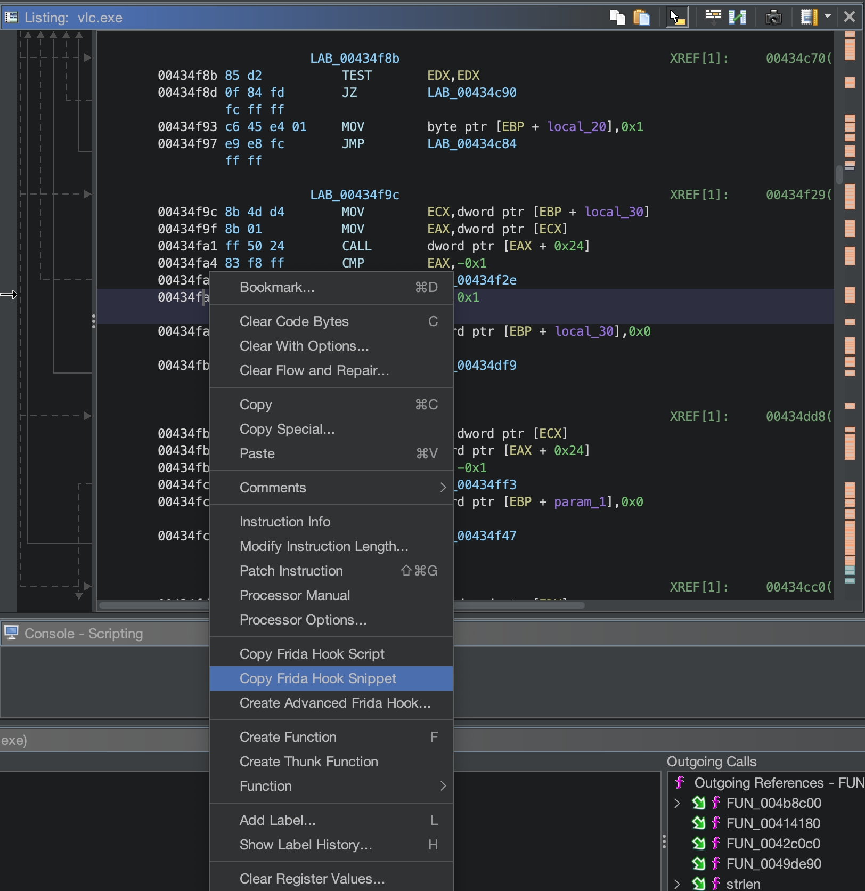
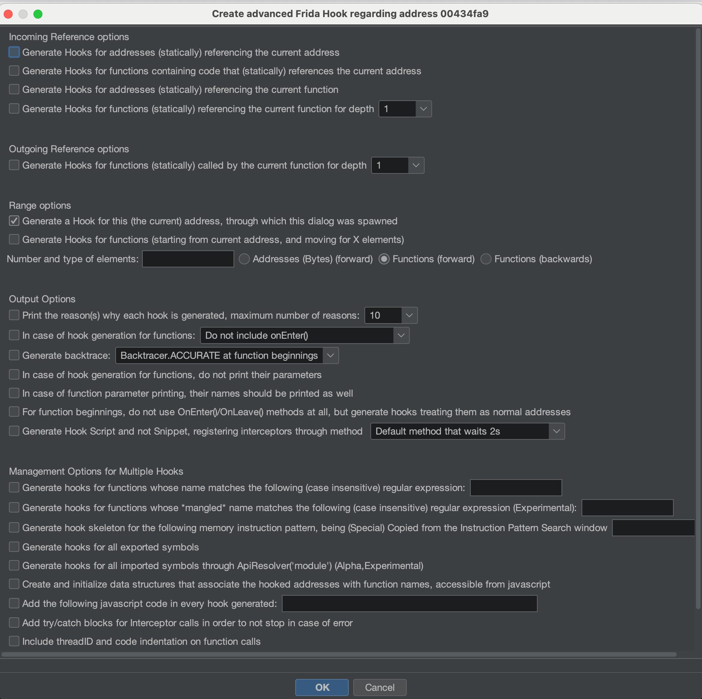
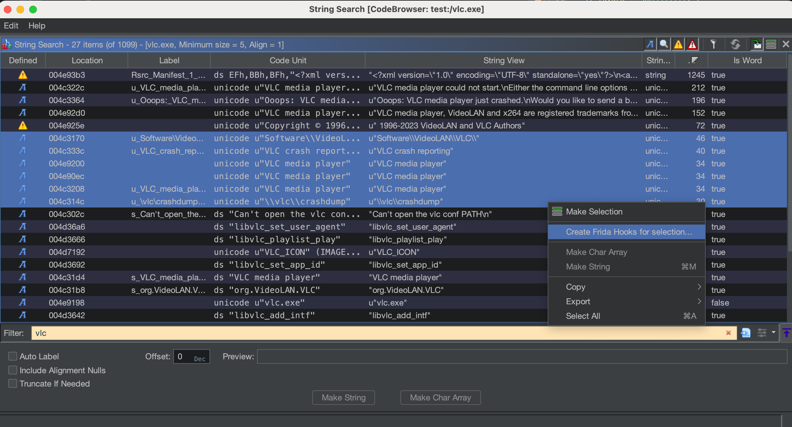
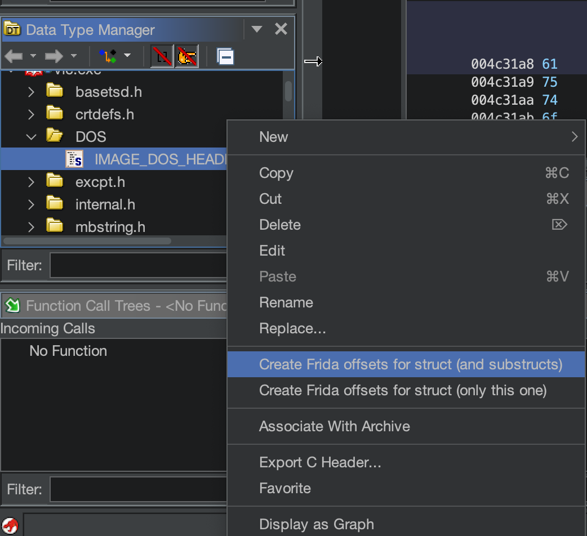

## Frida Hook generator for Ghidra

This plugin provides three new options in the right-click menu of the Listing Window in Ghidra:



- Copy Frida Hook Script: This one creates a valid frida script that generates a hook for the target address or function, and puts it into the clipboard. Usually this is supposed to be selected at first, to also generate the required skeleton code.
- Copy Frida Hook Snippet: This one creates a snippet that is meant to be put inside a generated script, and hooks the target address or function using the (assumed) predefined variables of that script. It is not a valid frida script in itself.
- Create Advanced Frida Hook: This one spawns a menu containing various options allowing for complex hook generation.

This extension supports both function-level hooking (when hooking the first address of a function), as well as arbitrary address hooking (when hooking inside a function).

It should be noted that the right-click should be done when hovering over the instruction address in the Listing Window. If for example it is done when hovering over a function name that the current instruction calls, the hook will be generated for that function, and not the current instruction.

#### Installation:

- Take the latest ghidra\_\<version\>\_PUBLIC\_\<date\>_frida_hook_generator.zip file which is inside the folder dist/ .
- From Ghidra (before opening a tool) -> File -> Install Extensions -> + sign -> Select the folder -> Make sure the frida_hook_generator is checked in the list of extensions
- Restart Ghidra
- Open CodeBrowser tool and analyze a binary. When asked if the new plugin should be configured, press "Yes" and make sure it is ticked. 

#### Usage:

- Open CodeBrowser tool and analyze a binary. If it is the first time after the installation, you will be asked if the new plugin should be configured. Press "Yes" and make sure it is ticked. 
- Right click at the Listing Window on an address and select "Copy Frida Hook Script".
- Paste the copied text into a file. Typically the first hook will be generated by the "Copy Script" option, and subsequent hooks by the "Copy Snippet" option.
- Run the binary through frida, for example `frida -f <binary> -l script.js` 

#### Notes:

- The Advanced Frida Hooks dialog offers multiple useful options, for generation of hooks for multiple related addresses at once:

  


- The "Copy Script" option introduces a 2-second delay for registering the interceptors. The reason for that is that a typical mobile application will not have all the dynamic libraries readily available at launch, for frida to hook into. As a quick fix, the script waits for a little and then tries to register the interceptors.  In certain cases, this means that the functions may be executed before frida hooks on them. If that is not desirable, it is possible to create code that registers the hooks when a particular library is loaded though dlopen() or LoadLibrary() through the Advanced Options.


- The generated script attempts to display a hooked function's parameters when it is called. However, usually the "Listing" window which contains the assembly code, does not reflect that parameter number. As such, the generated script will not contain code to print the correct number of parameters (usually it does not recognize any parameter, and as such it does not print anything). The solution to fix this is to right click on a function's name on the Ghidra "Decompiler" window, and select "Commit Params/Return". Then, the "Listing" window will recognize the correct number of parameters.


- The plugin also offers the ability to generate hooks for multiple addresses, as they have been identify from Ghidra's Search or other grouping options . First a selection must be created (Right click -> Make Selection), and then a new option is provided that can generate hooks for all the selected addresses. In effect, an Advanced Hook Generation dialog will be spawned that takes all the selected addresses as inputs. If for example the option "Generate hooks for addresses (statically) referencing the current address" is selected, then hooks for all the references of all the selected addresses will be generated.
  
  
  
  
  
  

- Another option provided by the plugin is the generation of javascript code that describes structs, so as to make their fields easily accessible by later hook code. Ghidra must know about the structs, this is typically done by parsing debug symbols but it is outside the scope of the plugin.
  
  
  
  


- As an example of the output of the plugin, here's a sample of the output code, for a function that starts at the offset 0x32450. The option "Copy Frida Hook Script" was used:

```
var module_name_vlc_exe='vlc.exe';

function start_timer_for_intercept() {
  setTimeout(
    function() {
        console.log("Registering interceptors...");
        
        
        var offset_of_FUN_00432450_00432450=0x32450;
        var dynamic_address_of_FUN_00432450_00432450=Module.findBaseAddress(module_name_vlc_exe).add(offset_of_FUN_00432450_00432450);
        Interceptor.attach(dynamic_address_of_FUN_00432450_00432450, {
                    onEnter: function(args) {
                        console.log("Entered FUN_00432450_00432450");
                        console.log('args[0]='+args[0]+' , args[1]='+args[1]+' , args[2]='+args[2]+' , args[3]='+args[3]);
                        // this.context.x0=0x1;
                    },
                    onLeave: function(retval) {
                        console.log("Exited FUN_00432450_00432450, retval:"+retval);
                        // retval.replace(0x1);
                    }
        }); 

        
        Interceptor.flush();
        console.log("Registered interceptors.");
    }, 2000);//milliseconds
}
start_timer_for_intercept();
```

If the option "Copy Frida Hook Snippet" is used, only the part in the middle will be returned (between the first `console.log()` and the `Interceptor.flush()`). 
The code when hooking a random address that is not the first address in a function looks like the following:

```
        var offset_of_0043246c=0x3246c;
        var dynamic_address_of_0043246c=Module.findBaseAddress(module_name_vlc_exe).add(offset_of_0043246c);
        function function_to_call_when_code_reaches_0043246c(){
            console.log('Reached address 0x0043246c, which is inside function FUN_00432450');
            //this.context.x0=0x1;
        }
        Interceptor.attach(dynamic_address_of_0043246c, function_to_call_when_code_reaches_0043246c); 

```

